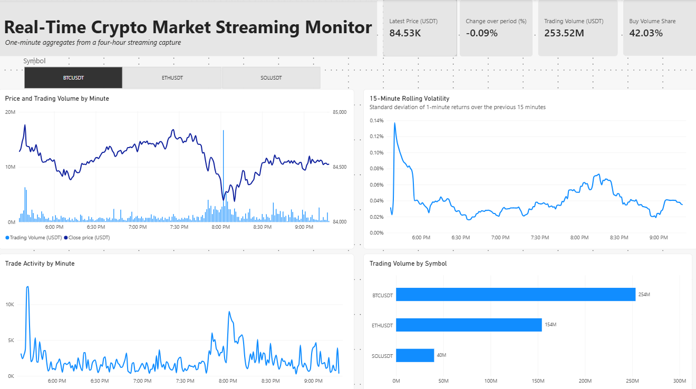

# Crypto Market Streaming Pipeline

[](https://github.com/tammem-benyoussef/crypto-streaming-pipeline/actions/workflows/ci.yml)

An end-to-end streaming data engineering project that turns Binance trade
events into one-minute market aggregates and a Power BI monitoring dashboard.



## Quick start

From the repository root:

```bash
cp .env.example .env
docker compose up -d --build
docker compose ps
```

The first build downloads the Spark and Python dependencies and may take several
minutes.

## Contents

- [What the project demonstrates](#what-the-project-demonstrates)
- [Architecture](#architecture)
- [Configuration](#configuration)
- [Run and inspect the pipeline](#run-and-inspect-the-pipeline)
- [Data model](#data-model)
- [Dashboard](#dashboard)
- [Verification](#verification)
- [Results](#results)
- [Limitations](#limitations)
- [Images and CI/CD](#images-and-cicd)
- [Project layout](#project-layout)
- [Local development](#local-development)

## What the project demonstrates

- Continuous ingestion from a real Binance WebSocket API.
- Kafka-compatible event streaming with Redpanda.
- Validation and dead-letter routing.
- Spark Structured Streaming with:
  - exchange event-time processing;
  - a 10-second watermark;
  - `(symbol, trade_id)` deduplication;
  - one-minute windowed aggregation;
  - checkpointing;
  - idempotent PostgreSQL upserts.
- WebSocket reconnect with capped exponential backoff.
- WebSocket ping/pong health checks.
- Graceful SIGTERM/SIGINT handling and Kafka producer flushing.
- A Power BI dashboard for price, volume, trading activity, and volatility.

The producer does **not** currently implement trade-ID gap detection or an
application-level idle watchdog. It can report connection loss and reconnect,
but it cannot recover trades missed during a disconnect.

This is a near-real-time monitoring pipeline, not a trading system. Its purpose
is to demonstrate continuous ingestion, processing, persistence, and observable
data freshness.

## Architecture

```text
Binance WebSocket
        |
        v
Python producer
        |
        v
    trades.raw
        |
        v
Python validator
    |           \
    v            v
trades.v1    trades.dlq
    |
    v
Spark Structured Streaming
1-minute event-time bars
    |
    v
PostgreSQL: live.bars_1m
    |
    v
Power BI dashboard
```

### Producer

`producer/` connects to Binance's combined trade stream for the configured
symbols. It preserves each received payload inside an envelope with
`received_at_ms` and publishes it to `trades.raw`.

The producer reconnects after a network failure or exchange connection
rotation. It uses one-second receive polling so SIGTERM can stop the loop
promptly, and flushes pending Kafka messages during shutdown.

### Validator

`validator/` consumes `trades.raw`, validates and normalizes each trade, then
writes valid records to `trades.v1` and invalid records to `trades.dlq`.
Output is delivered before the input offset is committed. This is an
at-least-once design for messages successfully read from `trades.raw`: a crash
after output delivery but before the offset commit can cause the message to be
processed again, but the ordering avoids silently losing it. Valid output is
deduplicated by Spark on `(symbol, trade_id)` while the watermark retains that
deduplication state; DLQ records do not have that downstream deduplication
guarantee.

### Spark Structured Streaming

`spark_jobs/` consumes `trades.v1`, parses the normalized schema, uses the
exchange trade timestamp as event time, deduplicates trade IDs, and aggregates
one-minute bars. The default trigger is 10 seconds and the default watermark is
10 seconds.

The trigger controls how often Spark checks for available input. It does not
change the one-minute output grain. The streaming query uses append mode, so
only finalized bars are written to PostgreSQL.

### PostgreSQL

PostgreSQL stores the output in `live.bars_1m`. Spark upserts by
`(symbol, window_start)` so a bar can be updated safely while accepted late
events are still within the watermark.

### Redpanda

Redpanda provides the Kafka API used by the producer, validator, and Spark.
The local Compose setup uses one broker and creates `trades.raw`, `trades.v1`,
and `trades.dlq` with three partitions.

## Configuration

Create a local environment file:

```bash
cp .env.example .env
```

Set the local PostgreSQL values in `.env`:

```env
POSTGRES_USER=crypto
POSTGRES_PASSWORD=change-me
POSTGRES_DB=crypto
POSTGRES_PORT=5432
SYMBOLS=BTCUSDT,ETHUSDT,SOLUSDT
```

`.env` is local configuration and must not be committed. `.env.example` is the
safe template intended for version control. The producer also supports
`BINANCE_WS_BASE`, and Spark supports `WATERMARK_DELAY`, `TRIGGER_INTERVAL`,
and `CHECKPOINT_DIR`.

## Run and inspect the pipeline

Validate the Compose file and start the stack:

```bash
docker compose config
docker compose up -d --build
docker compose ps
```

Follow the streaming logs:

```bash
docker compose logs -f producer validator spark
```

List the topics:

```bash
docker compose exec redpanda rpk topic list
```

Inspect topic offsets:

```bash
docker compose exec redpanda rpk topic describe trades.raw
docker compose exec redpanda rpk topic describe trades.v1
docker compose exec redpanda rpk topic describe trades.dlq
```

Inspect the most recent bars:

```bash
docker compose exec postgres psql \
  -U "$POSTGRES_USER" \
  -d "$POSTGRES_DB" \
  -c 'SELECT symbol, window_start, trade_count, quote_volume, close
      FROM live.bars_1m
      ORDER BY window_start DESC
      LIMIT 10;'
```

If those shell variables are not loaded in the current terminal, replace them
with the values from `.env`.

Stop the stack without deleting named volumes:

```bash
docker compose down
```

For a deliberately clean demonstration run, remove the Redpanda, PostgreSQL,
and Spark checkpoint volumes as well:

```bash
docker compose down -v
```

## Data model

### PostgreSQL: `live.bars_1m`

| Column | Meaning | Unit |
|---|---|---|
| `symbol` | Binance trading symbol | Symbol code |
| `window_start` | Start of the one-minute event-time window | UTC timestamp |
| `window_end` | End of the one-minute event-time window | UTC timestamp |
| `trade_count` | Number of deduplicated trades in the window | Trades |
| `base_volume` | Total traded quantity | Coin/base-asset units |
| `buy_base_volume` | Taker-buy quantity, where `is_buyer_maker` is false | Coin/base-asset units |
| `quote_volume` | Total traded quote value | USDT |
| `vwap` | `quote_volume / base_volume` | USDT per coin |
| `open` | First price in event-time order | USDT per coin |
| `high` | Highest price in the window | USDT per coin |
| `low` | Lowest price in the window | USDT per coin |
| `close` | Last price in event-time order | USDT per coin |

### `trades.raw`

The producer keeps the received payload in an envelope:

```json
{
  "received_at_ms": 1700000000200,
  "payload": {
    "e": "trade",
    "s": "BTCUSDT",
    "t": 12345,
    "p": "65000.10",
    "q": "0.002",
    "T": 1700000000120,
    "m": false
  }
}
```

### `trades.v1`

The validator emits normalized valid trades:

```json
{
  "symbol": "BTCUSDT",
  "trade_id": 12345,
  "price": 65000.10,
  "quantity": 0.002,
  "quote_quantity": 130.0002,
  "trade_time_ms": 1700000000120,
  "is_buyer_maker": false,
  "received_at_ms": 1700000000200
}
```

### `trades.dlq`

Invalid input is retained with a reason and failure timestamp:

```json
{
  "reason": "missing fields",
  "raw": "{\"received_at_ms\":1,\"payload\":{}}",
  "failed_at_ms": 1700000001000
}
```

Spark's event time is `trade_time_ms`, the exchange's trade timestamp. It is
not Kafka's message timestamp and not the producer's `received_at_ms`.

The default 10-second watermark means Spark keeps state for events whose
exchange event time is up to approximately 10 seconds behind the observed
event-time progress. Events arriving later than that may be excluded from the
finalized aggregation and are not logged by a separate late-event sink.

## Dashboard

The `dashboard/crypto.pbix` file is an **Import-mode snapshot** of an
approximately four-hour capture. The report contains a copy of the data
imported when that file was created; it does not query this repository's
PostgreSQL instance or update merely because the upstream pipeline is
streaming. The PNG above is a static preview.

In this README, a **live connection** means that Power BI is configured to
query the running PostgreSQL database (or to refresh an imported dataset).
Streaming in the producer, Kafka, and Spark services only updates the pipeline
and its database; it does not establish a Power BI connection or push updates
to an already-imported PBIX file.

The report contains Power BI measures for latest price, selected-period price
change, USDT volume, buy-volume share, and rolling volatility. Volatility is
computed in Power BI DAX, not in PostgreSQL:

> At each plotted minute, rolling volatility is the sample standard deviation
> of one-minute percentage returns, `(close_t - close_(t-1)) / close_(t-1)`,
> over the previous 15 minutes for the selected symbol. The first window has
> insufficient history and may be blank.

### Repoint the report for live PostgreSQL use

In Power BI Desktop, change the PostgreSQL source to:

- **Server:** `localhost:<POSTGRES_PORT>` where `POSTGRES_PORT` comes from `.env`
- **Database:** the value of `POSTGRES_DB` from `.env`
- **Connection mode:** DirectQuery

Then configure page refresh at an interval supported by the Power BI edition and
connection. DirectQuery queries PostgreSQL when the visuals or report refresh;
it is therefore closer to live monitoring, but it does not push every incoming
trade to the report or remove Power BI's refresh and capacity limitations.

## Verification

The repository currently contains:

- a pytest suite under `tests/`;
- `scripts/verify_bars.py`, an independent pandas reference comparison that
  recounts `trades.v1` and compares finalized bars with `live.bars_1m`.

## Results

The following figures are marked as **observed locally** from this project:

- Approximately **75 trades per second observed locally** across three symbols.
- Approximately **140 ms observed locally** between exchange trade time and
  producer receipt time.
- Approximately **4,300 one-minute bars per day observed locally** for three
  symbols.

TODO(me): add repeatable benchmark commands and environment details for these
observations.


## Design decisions

The raw topic is kept unmodified before validation so events remain available
for replay and debugging. The trade-off is one extra service and topic.

The pipeline uses at-least-once delivery with idempotent PostgreSQL upserts
instead of claiming end-to-end exactly-once processing. For messages the
validator has read from `trades.raw`, it writes output before committing the
input offset, so a failure between those operations can create duplicates but
does not silently lose the input. The producer can still miss exchange trades
during a WebSocket disconnect, as noted above, because there is no exchange
trade-ID gap detector or historical backfill.

Spark uses append mode so PostgreSQL receives finished bars rather than
constantly changing partial results. Bars may appear roughly 20–80 seconds
after their minute ends depending on processing and watermark progress; late
data is dropped silently and there is no late-event log.

One-minute bars are the canonical base grain. Coarser views should be computed
at read time instead of maintaining multiple Spark aggregation pipelines.
Spark Structured Streaming was chosen for its existing Spark SQL and
micro-batch integration; Flink would offer a different streaming runtime but
would add another platform to operate.

Redpanda was chosen as the local Kafka-API broker to keep the stack compact.
The producer currently supports one exchange, Binance, and there is no
historical backfill path.

## Images and CI/CD

The CI workflow in `.github/workflows/ci.yml` runs Ruff linting, a Ruff format
check, pytest, Compose validation, and Docker image builds.

The release workflow in `.github/workflows/release.yml` currently runs on every
push to `main` (despite its image metadata also defining semver-style tags). It
publishes these images to GitHub Container Registry:

```text
ghcr.io/tammem-benyoussef/crypto-streaming-producer
ghcr.io/tammem-benyoussef/crypto-streaming-validator
ghcr.io/tammem-benyoussef/crypto-streaming-spark-job
```

Example:

```bash
docker pull ghcr.io/tammem-benyoussef/crypto-streaming-producer:latest
```

The workflow currently does not use a `v*` tag trigger. If releases should be
published only for version tags, that workflow behavior still needs to be
changed.

## Project layout

```text
common/                 Shared parsing helpers
producer/               Binance WebSocket producer and image definition
validator/              Trade validation, normalization, and DLQ routing
spark_jobs/             Spark streaming query and pure transformations
sql/init/               PostgreSQL schema and table initialization
tests/                  Unit and transformation tests
scripts/                Bar verification and local job helper scripts
dashboard/              Power BI report and dashboard screenshot
docker-compose.yml      Local Redpanda, PostgreSQL, and streaming services
pyproject.toml          Python dependencies and tool configuration
uv.lock                Reproducible Python dependency lock file
```

## Local development

Install or synchronize the development environment:

```bash
uv sync
```

Run the tests:

```bash
uv run pytest
```

Run linting:

```bash
uv run ruff check .
```

Run the formatting check used by CI:

```bash
uv run ruff format --check .
```
